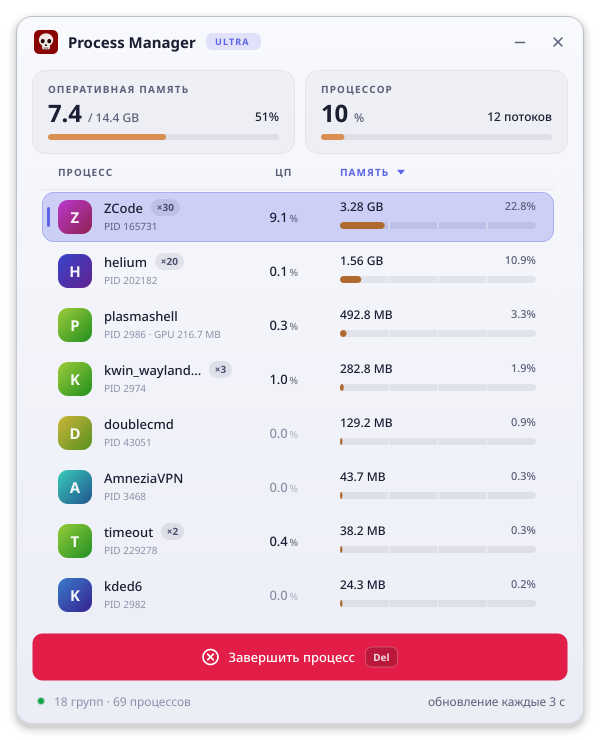

# ProcessKill

[English](#english) | [Русский](#русский)

---

## English

A compact Linux process manager in a single Python file: processes are grouped by their root ancestor, memory is counted precisely (PSS), and a runaway chain of processes is killed with one press of the Delete key.

Python + PyQt6, Linux only. Interface language: Russian.

<p align="center">
  
  
</p>

### Features

- **Grouping by root ancestor** — a chain of child processes is one row with a `×N` counter; CPU and memory are summed across the whole group
- **Accurate memory** — PSS (shared memory included, Anon + File + Shmem) plus GPU-shared memory (GTT), with a bar against total RAM
- **Kill a group** — SIGTERM, then SIGKILL after 1.5 s; by button or by the Delete key
- **Sorting** — by CPU or by memory, one click on the column header
- **Low-noise list** — session services (dbus, gvfs, pipewire, …) are hidden; shows your user's processes plus anything consuming more than 3% CPU or 150 MB of RAM
- **Flicker-free updates** — the list refreshes every 3 s keeping the selection
- **RAM / CPU summary cards**, dark and light themes

### Run

```bash
pip install psutil PyQt6
python3 ProcessKill.py
```

Or grab the ready **AppImage** from [Releases](../../releases) — no Python needed:

```bash
chmod +x ProcessKill-2.1.0-x86_64.AppImage
./ProcessKill-2.1.0-x86_64.AppImage
```

### Diagnostics

Not sure why a process is missing from the list?

```bash
python3 ProcessKill.py --why <part-of-name>
```

### Dependencies

| Package | Purpose |
|---|---|
| [PyQt6](https://pypi.org/project/PyQt6/) | UI |
| [psutil](https://pypi.org/project/psutil/) | process and memory info (`/proc`) |

---

## Русский

Компактный менеджер процессов для Linux в одном Python-файле: процессы группируются по корневому предку, память считается точно (PSS), а runaway-цепочку процессов можно завершить одним нажатием Delete.

Python + PyQt6, только Linux. Интерфейс — русский.

<p align="center">
  
  
</p>

### Возможности

- **Группировка по корневому предку.** Цепочка дочерних процессов — одна строка со счётчиком `×N`; ЦП и память суммируются по всей группе.
- **Точная память.** PSS (включая разделяемую: Anon + File + Shmem) плюс память GPU, переехавшая в RAM (GTT). Рядом — бар от общей памяти системы.
- **Завершение группы.** SIGTERM, через 1.5 с — SIGKILL. Кнопкой или клавишей Delete.
- **Сортировка** по ЦП или памяти — клик по заголовку столбца, повторный клик меняет направление.
- **Низкий шум списка.** Системные службы сессии (dbus, gvfs, pipewire и т.п.) скрыты; показываются процессы вашего пользователя и всё, что потребляет больше 3% ЦП или 150 МБ памяти.
- **Обновление без мерцания** каждые 3 с — выделенная строка сохраняется.
- **Карточки RAM / ЦП** сверху, тёмная и светлая темы.

### Запуск

```bash
pip install psutil PyQt6
python3 ProcessKill.py
```

Или возьмите готовый **AppImage** из [Releases](../../releases) — Python не нужен:

```bash
chmod +x ProcessKill-2.1.0-x86_64.AppImage
./ProcessKill-2.1.0-x86_64.AppImage
```

### Диагностика

Не понимаете, почему процесса нет в списке?

```bash
python3 ProcessKill.py --why <часть имени>
```

### Зависимости

| Пакет | Назначение |
|---|---|
| [PyQt6](https://pypi.org/project/PyQt6/) | интерфейс |
| [psutil](https://pypi.org/project/psutil/) | информация о процессах и памяти (`/proc`) |

---

## License / Лицензия

[MIT](LICENSE)
